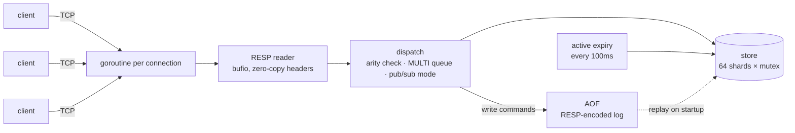

<div align="center">

```
   ____ ____ ___  _ ____
  / __// __// _ \(_) __/
 / (_ // _/ / // / /\ \
 \___//___//____/_/___/
```

**A Redis-compatible in-memory database, written from scratch in Go.**

[](https://github.com/TurhanSarimsak/gedis/actions/workflows/ci.yml)


</div>

gedis speaks the Redis wire protocol (RESP2), so **`redis-cli`, `redis-benchmark` and existing client libraries work against it unchanged**. It is built only on the Go standard library and is meant to be read: every design decision below is a real trade-off that Redis itself makes, or deliberately makes differently.

```console
$ go run ./cmd/gedis -aof appendonly.aof
$ redis-cli -p 6380
127.0.0.1:6380> SET user:1 turhan EX 60
OK
127.0.0.1:6380> TTL user:1
(integer) 60
127.0.0.1:6380> RPUSH queue job1 job2
(integer) 2
127.0.0.1:6380> MULTI
OK
127.0.0.1:6380(TX)> INCR visits
QUEUED
127.0.0.1:6380(TX)> LPOP queue
QUEUED
127.0.0.1:6380(TX)> EXEC
1) (integer) 1
2) "job1"
```

## Features

| | |
| --- | --- |
| **Protocol** | RESP2 parser and writer, inline commands (works over `telnet`), pipelining, fuzz-tested |
| **Data types** | Strings, lists, hashes |
| **Expiry** | `EX`/`PX`/`EXAT`/`PXAT`/`KEEPTTL`, lazy and active expiration |
| **Persistence** | Append-only file with `always` / `everysec` / `no` fsync policies and crash recovery |
| **Transactions** | `MULTI` / `EXEC` / `DISCARD`, atomic across all keys |
| **Pub/Sub** | `SUBSCRIBE` / `UNSUBSCRIBE` / `PUBLISH` with slow-consumer protection |
| **Operations** | `INFO`, graceful shutdown on SIGINT/SIGTERM, structured logging (`log/slog`) |

<details>
<summary><b>Supported commands (46)</b></summary>

`PING` `ECHO` `INFO` `COMMAND` `CLIENT` `SELECT` `QUIT` ·
`GET` `SET` `MGET` `MSET` `INCR` `DECR` `INCRBY` `DECRBY` ·
`DEL` `EXISTS` `TYPE` `KEYS` `DBSIZE` `FLUSHALL` `FLUSHDB` `EXPIRE` `PEXPIRE` `EXPIREAT` `PEXPIREAT` `TTL` `PTTL` `PERSIST` ·
`LPUSH` `RPUSH` `LPOP` `RPOP` `LRANGE` `LLEN` ·
`HSET` `HGET` `HDEL` `HGETALL` `HLEN` ·
`MULTI` `EXEC` `DISCARD` ·
`PUBLISH` `SUBSCRIBE` `UNSUBSCRIBE`

</details>

## Architecture



```
cmd/gedis/          entrypoint: flags, signals, graceful shutdown
internal/resp/      RESP2 protocol: Reader, Writer, fuzz test
internal/store/     sharded keyspace, data types, expiry, glob matching
internal/aof/       append-only file: append, fsync policies, replay, crash repair
internal/server/    connections, command table, transactions, pub/sub
```

## Design notes

### Concurrency: sharded locks instead of a single thread
Redis runs commands on one thread, so it needs no locks at all. gedis uses a goroutine per connection and splits the keyspace across **64 shards, each with its own mutex**, chosen by an inlined, allocation-free FNV-1a hash. Commands on different keys almost never contend.

That choice has consequences, and gedis handles them explicitly:

- **Transactions.** Per-shard locks alone can't make `MULTI/EXEC` atomic. Every command holds a server-wide `RWMutex` for reading; `EXEC` takes it for writing, so a transaction is never interleaved or observed half-applied. `TestTransactionAtomicity` checks this with concurrent transfers that must always sum to 100.
- **AOF ordering.** Two concurrent `SET k` from different clients could be applied in one order and logged in the other, and a restart would then resurrect the wrong value. With the AOF enabled, write commands are serialized while being applied and logged. Reads stay fully parallel.
- **Pub/Sub deadlocks.** `PUBLISH` copies the subscriber list before delivering, so it never holds the registry lock while waiting on a client. Pub/sub commands also never take the transaction lock, because `EXEC` may `PUBLISH` to a subscriber that is mid-`SUBSCRIBE`.

### Expiry: lazy + active, like Redis
- **Lazy:** every read checks the deadline and deletes expired keys on the spot, so expired data is never observable.
- **Active:** keys that are never read again would leak memory. Every 100 ms, gedis samples 20 keys that have a TTL from each shard and deletes the expired ones. If more than 25% of a sample was expired, it samples again. This is the algorithm Redis uses, adaptive to how much garbage exists. Go's randomized map iteration supplies the random sample for free.

### Persistence: the append-only file
Every write is appended as a RESP array, the same format clients send, and replayed through the normal command path on startup.

- **Relative TTLs are logged as absolute.** `SET k v EX 60` is written as `SET k v PXAT <unix-ms>`, and `EXPIRE` becomes `PEXPIREAT`. Otherwise every restart would give keys a fresh 60 seconds.
- **Crash recovery.** If the process dies halfway through writing a command, replay detects the torn tail, truncates the file back to the last complete command and continues. New writes then start on a clean boundary.
- **fsync policy** is the classic durability/throughput dial: `always` (fsync per write), `everysec` (default, lose at most ~1 s on power loss) or `no`.

### Protocol: pipelining and allocation-awareness
- Replies are buffered and only **flushed once the read buffer is drained**, so a pipeline of 100 commands costs one `write` syscall instead of 100.
- Integer and length prefixes are formatted into a reused scratch buffer with `strconv.AppendInt`, so the reply path doesn't allocate.
- Lengths are bounded (64 MiB per argument, 1M arguments) so a malicious header can't make the server allocate unbounded memory. The parser is **fuzzed** with Go's native fuzzer (3M+ executions without a crash).
- Error messages are stripped of CR/LF, so user-supplied text echoed in an error (`ERR unknown command '...'`) can't inject protocol frames.

## Benchmarks

Measured on an AMD Ryzen 7 8700F with `go test -bench`:

| Benchmark | Result |
| --- | --- |
| `SET` over one TCP connection, pipeline depth 100 | **~1.76M ops/s** (568 ns/op) |
| Store `SET` + `GET`, 8 goroutines in parallel | **54 ns** per pair |

CI also runs the official `redis-benchmark` against gedis on every push. See the [Actions logs](https://github.com/TurhanSarimsak/gedis/actions).

## Running

```bash
go run ./cmd/gedis                                   # :6380, in-memory only
go run ./cmd/gedis -aof appendonly.aof               # with persistence
go run ./cmd/gedis -aof data.aof -appendfsync always # maximum durability
```

Or with Docker:

```bash
docker build -t gedis .
docker run -p 6380:6380 -v gedis-data:/data gedis
```

## Testing

```bash
go test -race ./...                                            # unit + integration tests
go test ./internal/resp -fuzz FuzzReadCommand -fuzztime 30s    # fuzz the parser
go test ./internal/... -run '^$' -bench .                      # benchmarks
```

The integration tests drive a real TCP server through the wire protocol. They cover pipelining, inline commands, transactions under concurrency, pub/sub, and an AOF restart after a simulated mid-write crash. CI additionally runs gedis against the real `redis-cli`.

## Not implemented (yet)

Sets and sorted sets, `WATCH`, RESP3 / `HELLO`, replication, RDB snapshots and AOF rewriting. Each would be a good next chapter.

## License

[MIT](LICENSE) © Turhan Sarımsak
